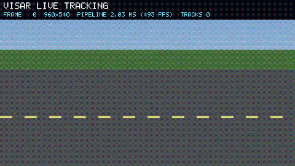

# VISAR

**Visual Imaging, Sensing, and Recognition**: a dependency-free computer-vision library in Zig, built as a full replacement for OpenCV.



*Rendered on every push by a stock GitHub Actions runner ([demos workflow](.github/workflows/demos.yml)). The pipeline is gray → Gaussian 5×5 → background subtraction → morphology → connected components → multi-object tracker, entirely in VISAR. The job summary shows its frame rate, its accuracy against the synthetic scene's ground truth, and a full speed comparison against OpenCV on the same runner.*

```sh
curl -fsSL https://raw.githubusercontent.com/plyght/VISAR/main/install.sh | sh
```

- **No dependencies.** Only the Zig compiler; codecs, maths and threading are all in-tree. Cross-compile to any target from any host.
- **Matches OpenCV.** 741 differential cases against OpenCV 5.0 pass on every change (`zig build difftest`). Most are bit-exact; the few tolerances are documented in the test file.
- **Fast.** SIMD kernels on `@Vector`, a persistent thread pool, fixed-point paths that mirror OpenCV's arithmetic, and a pure-Zig PNG codec that decodes faster than OpenCV's.
- **Runs anywhere.** Linux, macOS, Windows, wasm32-wasi; aarch64, x86_64 and riscv64.
- **Usable from anything.** An idiomatic Zig API plus a stable C ABI (`include/visar.h`) as shared and static libraries.

Speed against OpenCV 5.0 is measured on every push on stock GitHub runners (x86-64 and Apple Silicon); see the [demos workflow](.github/workflows/demos.yml) job summaries. On Apple Silicon the median speedup across 32 kernels is about 2x with all cores.

See [PRD.md](PRD.md) for the full scope and roadmap. VISAR is early: the roadmap's M0 (foundations) is in place and M1 (core imaging) is in progress.

## What works today

| Area | Status |
| --- | --- |
| Core | `Image(T)` with strided views, `AnyImage`, saturating arithmetic, `convertTo`, `addWeighted`, reductions, split/merge, thread pool |
| imgproc | `cvtColor` (gray, BGR/RGB/A reorders, HSV, YCrCb), resize (nearest, linear, area, cubic), Gaussian/box/Sobel/Scharr/separable filters, threshold (incl. Otsu, triangle), `inRange`, morphology (all `morphologyEx` ops and element shapes), flip/rotate/transpose, `warpAffine`/`warpPerspective`, `copyMakeBorder`, `equalizeHist`, `integral`, `connectedComponentsWithStats`, `findContours` (all modes and methods, exact), shape analysis (moments, Hu, area, length, hulls, defects, minAreaRect, minEnclosingCircle, fitEllipse, approxPolyDP, pointPolygonTest, matchShapes), drawing (incl. OpenCV-exact `drawContours`, `fillPoly`, `polylines`) |
| Codecs | PNG (all colour types and depths, Adam7; custom inflate), JPEG (in progress), QOI, PNM/PAM, BMP (incl. RLE), animated GIF (encode) |
| dnn | ONNX inference engine (protobuf reader, graph IR, fusion passes, liveness memory plan with in-place concatenation, blocked-layout SIMD CPU kernels with row-streamed conv chains and cache-blocked GEMM-class convolutions; a Metal GPU backend on macOS that runs the whole plan in one command buffer, loaded at run time with no SDK); `FaceDetector` runs YuNet with results matching `cv2.FaceDetectorYN` and about 3.5x faster on CPU; `ObjectDetector` runs the Model Zoo's NanoDet and YOLOX (COCO) with the zoo pipelines' detections, faster than `cv2.dnn` |
| Video | Background subtraction, multi-object tracker, MOSSE correlation tracker (follows a selected object, ~5000 updates/s per object with its three-scale search) |
| Interfaces | Zig module, C ABI, `visar` CLI (clig.dev-style: JSON output, helpful errors, pipelines, bench, demos) |

## Build

Needs Zig 0.17.0.

```sh
zig build -Doptimize=ReleaseFast          # library, C ABI (zig-out/lib) and CLI (zig-out/bin/visar)
zig build test                            # unit tests
zig build difftest -Doptimize=ReleaseSafe # compare against OpenCV (needs python3, numpy, opencv-python-headless)
zig build bench -Doptimize=ReleaseFast -- --threads 1   # speed vs OpenCV
zig build face4k -Doptimize=ReleaseFast         # the 4K face pipeline vs OpenCV, stage by stage (needs VISAR_MODELS)
zig build demo-track -Doptimize=ReleaseFast -- --out track.gif
```

## Command line

```console
$ visar inspect photo.png photo.jpg
FILE       FORMAT     SIZE  CHANNELS  DEPTH     BYTES
─────────  ──────  ───────  ────────  ─────  ────────
photo.png  png     480x270  3 RGB     u8     33.2 KiB
photo.jpg  jpeg    480x270  3 RGB     u8     49.9 KiB

$ visar resize photo.png thumb.png 320x
  ✓ thumb.png  320×180 RGB 8-bit · PNG 72.9 KiB · 22.76 ms · area

$ visar pipeline scan.jpg mask.png -- gray , blur --sigma 1.5 , threshold --otsu , morph open
$ cat photo.png | visar gray - - --format png | visar inspect -
$ visar demo track --out track.gif          # the demo above, on your machine
$ visar bench --filter blur,resize          # time the kernels on this CPU
```

### Live tracking and face tracking

`visar track` runs a tracker on the camera (macOS, Linux) in a window: moving objects by default, objects you drag a box around (MOSSE locks), or faces:

```sh
curl -LO https://media.githubusercontent.com/media/opencv/opencv_zoo/main/models/face_detection_yunet/face_detection_yunet_2023mar.onnx
visar track --faces face_detection_yunet_2023mar.onnx
```

Faces are detected with YuNet (`visar.dnn.FaceDetector`) and followed by MOSSE filters between detections, so the network runs on a fraction of the frames: every `--detect-every` frames (default 4), or at once when a face is lost. Scheduled detections are postponed while the picture does not change, and most of them run only on crops around the tracked faces (`--change-level`, PRD §8.6 "change-driven inference"); every fourth one still covers the whole frame to find new faces. The HUD and the `--json` summary show the faces, the detector's time per run, its rate, and how many frames it skipped or ran crop-only. `--source image:PATH` moves a still picture over a canvas, so the same pipeline can be tried and checked against a known motion anywhere:

```sh
visar track --faces face_detection_yunet_2023mar.onnx --source image:selfie.jpg --face-width 640 --headless --frames 600 --json
```

### 4K face detection: measured, and what 120 fps on an M3 needs

`zig build face4k -Doptimize=ReleaseFast` (needs `VISAR_MODELS` with the YuNet model and `largest_selfie.jpg`) times the whole pipeline on a camera-native 3840x2160 BGRA frame (the zoo selfie enlarged to 4K): colour + downscale straight into the network's planar f32 input in one pass (`FaceDetector.prepare`, bit-identical to `cvtColor` + `resize(INTER_AREA)` + `blobFromImage`), YuNet on the CPU, boxes mapped back to 4K, against `cv2.cvtColor` + `cv2.resize` + `cv2.FaceDetectorYN` at the same thread count. The detector runs at 640x360 (4K / 6): it finds faces from about 190 px wide at 4K (5% of the frame width; 960x540 finds them from about 124 px at roughly twice the network cost). Both libraries return the same boxes. Median ms (GitHub `macos-latest`, an M1-class VM; x86 is a 4-core Sapphire Rapids VM with AVX-512):

| 640x360, ms | macOS 1T | macOS 3T | macOS 5T¹ | x86 1T | x86 4T |
| --- | ---: | ---: | ---: | ---: | ---: |
| colour + downscale into the input | 1.99 | 1.32 | 0.45 | 2.05 | 0.58 |
| YuNet (CPU; 206 M MACs) | 7.59 | 2.64 | 1.53 | 4.91 | 1.95 |
| decode + NMS + map to 4K | 0.01 | 0.01 | 0.01 | 0.01 | 0.01 |
| **VISAR end to end** | **9.97** | **3.52** | **2.03** | **7.11** | **2.84** |
| OpenCV end to end | 26.19 | 12.42 | 8.05 | 28.41 | 9.98 |
| VISAR change-driven steady state² | 4.45 | 3.06 | 1.09 | 3.48 | 1.39 |

¹ A second `macos-latest` run that got a 5-core VM (1T end to end there: 9.75 ms). ² `visar track`'s face tracker at level 2, a detection scheduled every 4th frame, the selfie moving slowly over a 4K canvas (`bench/face4k_steady.zig`): effective ms per frame including the gray tracking image (1.5-3 ms of it at 1T: one more pass over the 4K frame) and MOSSE; whole-frame detections run on 38 of 600 frames, crop-only ones on 84, 112 are skipped as unchanged. The runners are noisy VMs: medians move by 20-50% between runs (the bench prints the minimum too).

So on the M1-class runner the end-to-end detection of every 4K frame already fits 8.3 ms with 3 threads (284 fps) and the change-driven tracker fits it on one thread. *Extrapolation, not measured:* an M3 performance core runs scalar and NEON code roughly 1.3-1.4x faster than an M1's and a base M3 has 4 of them, so the one-thread end-to-end time would be about 7 ms (just inside 8.3 ms with no headroom) and about 2 ms on the performance cores; 960x540 (about 15 ms on one M1 thread) needs at least 2-3 cores. What blocks a comfortable 4K120 on one M3 core is the network (75% of the time, at about 55% of the core's FMA peak; the first two row-streamed chains of 3x3/1x1 convs at full resolution take 60% of it); the per-frame gray tracking image is the next cost once detections are change-driven. The Metal backend ran YuNet in 2-4 ms on the runners' paravirtual GPU, which says nothing about a real M3 GPU.

Commands: `info`, `inspect`, `convert`, `resize`, `rotate`, `flip`, `gray`, `blur`, `threshold`, `edges`, `equalize`, `morph`, `pipeline`, `bench`, `demo`, `track`. Every command takes `--json`, `--threads`, `-q` and `-v`. Errors come with a hint, and mistyped commands, options and file names get a "did you mean". An existing output file is never overwritten without `-f`. Run `visar help <command>` for examples.

## Use from Zig

```sh
zig fetch --save git+https://github.com/plyght/VISAR
```

```zig
// build.zig
exe.root_module.addImport("visar", b.dependency("visar", .{}).module("visar"));
```

```zig
const visar = @import("visar");

pub fn main(init: std.process.Init) !void {
    const gpa = init.gpa;
    var pool = visar.Pool.init(gpa, init.io, null);
    defer pool.deinit();
    const exec = visar.Exec.on(&pool);

    var img = try visar.codecs.read(gpa, init.io, "in.png", .{ .mode = .color });
    defer img.deinit(gpa);
    const src = img.u8;

    var gray = try visar.Image(u8).init(gpa, src.width, src.height, 1);
    defer gray.deinit(gpa);
    try visar.imgproc.cvtColor(exec, src, gray, .rgb2gray);

    var blurred = try visar.Image(u8).initLike(gpa, gray);
    defer blurred.deinit(gpa);
    try visar.imgproc.gaussianBlur(exec, gpa, gray, blurred, .{ .sigma_x = 2 });

    try visar.codecs.write(gpa, init.io, "out.png", .{ .u8 = blurred }, .{});
}
```

Kernels never allocate behind your back: anything that needs scratch memory takes an allocator, and threading goes through an explicit `Exec` (`.serial` or a pool).

## Use from C

```c
#include <visar.h>

visar_image src, dst = { w, h, 1, VISAR_8U, w, out_pixels };
visar_imdecode(bytes, len, /*mode*/ 1, /*bgr*/ 1, &src);
visar_cvt_color(&src, &dst, /*COLOR_BGR2GRAY*/ 6);
visar_image_free(&src);
```

Constants use OpenCV's numbering, so porting code is mostly mechanical.

## License

AGPL-3.0-or-later. See [LICENSE](LICENSE).
