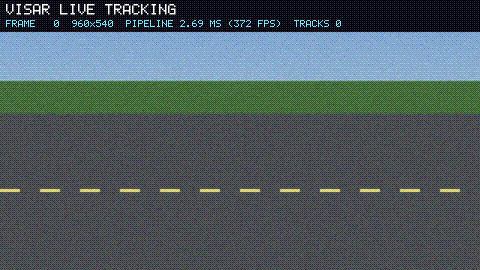

# VISAR

**Visual Imaging, Sensing, and Recognition**: a dependency-free computer-vision library in Zig, built as a full replacement for OpenCV.



*Rendered on every push by a stock GitHub Actions runner ([demos workflow](.github/workflows/demos.yml)). The pipeline is gray → Gaussian 5×5 → background subtraction → morphology → connected components → multi-object tracker, entirely in VISAR. The job summary shows its frame rate, its accuracy against the synthetic scene's ground truth, and a full speed comparison against OpenCV on the same runner.*

- **No dependencies.** Only the Zig compiler; codecs, maths and threading are all in-tree. Cross-compile to any target from any host.
- **Matches OpenCV.** 741 differential cases against OpenCV 5.0 pass on every change (`zig build difftest`). Most are bit-exact; the few tolerances are documented in the test file.
- **Fast.** SIMD kernels on `@Vector`, a persistent thread pool, fixed-point paths that mirror OpenCV's arithmetic, and a pure-Zig PNG codec that decodes faster than OpenCV's.
- **Runs anywhere.** Linux, macOS, Windows, wasm32-wasi; aarch64, x86_64 and riscv64.
- **Usable from anything.** An idiomatic Zig API plus a stable C ABI (`include/visar.h`) as shared and static libraries.

See [PRD.md](PRD.md) for the full scope and roadmap. VISAR is early: the roadmap's M0 (foundations) is in place and M1 (core imaging) is in progress.

## What works today

| Area | Status |
| --- | --- |
| Core | `Image(T)` with strided views, `AnyImage`, saturating arithmetic, `convertTo`, `addWeighted`, reductions, split/merge, thread pool |
| imgproc | `cvtColor` (gray, BGR/RGB/A reorders, HSV, YCrCb), resize (nearest, linear, area, cubic), Gaussian/box/Sobel/Scharr/separable filters, threshold (incl. Otsu, triangle), `inRange`, morphology (all `morphologyEx` ops and element shapes), flip/rotate/transpose, `warpAffine`/`warpPerspective`, `copyMakeBorder`, `equalizeHist`, `integral`, `connectedComponentsWithStats`, drawing |
| Codecs | PNG (all colour types and depths, Adam7; custom inflate), JPEG (in progress), QOI, PNM/PAM, BMP (incl. RLE), animated GIF (encode) |
| Video | Background subtraction, multi-object tracker |
| Interfaces | Zig module, C ABI, `visar` CLI |

## Build

Needs Zig 0.17.0.

```sh
zig build -Doptimize=ReleaseFast          # library, C ABI (zig-out/lib) and CLI (zig-out/bin/visar)
zig build test                            # unit tests
zig build difftest -Doptimize=ReleaseSafe # compare against OpenCV (needs python3, numpy, opencv-python-headless)
zig build bench -Doptimize=ReleaseFast -- --threads 1   # speed vs OpenCV
zig build demo-track -Doptimize=ReleaseFast -- --out track.gif
```

## Use from Zig

```sh
zig fetch --save git+https://github.com/plyght/VISAR
```

```zig
// build.zig
exe.root_module.addImport("visar", b.dependency("visar", .{}).module("visar"));
```

```zig
const visar = @import("visar");

pub fn main(init: std.process.Init) !void {
    const gpa = init.gpa;
    var pool = visar.Pool.init(gpa, init.io, null);
    defer pool.deinit();
    const exec = visar.Exec.on(&pool);

    var img = try visar.codecs.read(gpa, init.io, "in.png", .{ .mode = .color });
    defer img.deinit(gpa);
    const src = img.u8;

    var gray = try visar.Image(u8).init(gpa, src.width, src.height, 1);
    defer gray.deinit(gpa);
    try visar.imgproc.cvtColor(exec, src, gray, .rgb2gray);

    var blurred = try visar.Image(u8).initLike(gpa, gray);
    defer blurred.deinit(gpa);
    try visar.imgproc.gaussianBlur(exec, gpa, gray, blurred, .{ .sigma_x = 2 });

    try visar.codecs.write(gpa, init.io, "out.png", .{ .u8 = blurred }, .{});
}
```

Kernels never allocate behind your back: anything that needs scratch memory takes an allocator, and threading goes through an explicit `Exec` (`.serial` or a pool).

## Use from C

```c
#include <visar.h>

visar_image src, dst = { w, h, 1, VISAR_8U, w, out_pixels };
visar_imdecode(bytes, len, /*mode*/ 1, /*bgr*/ 1, &src);
visar_cvt_color(&src, &dst, /*COLOR_BGR2GRAY*/ 6);
visar_image_free(&src);
```

Constants use OpenCV's numbering, so porting code is mostly mechanical.

## License

AGPL-3.0-or-later. See [LICENSE](LICENSE).
